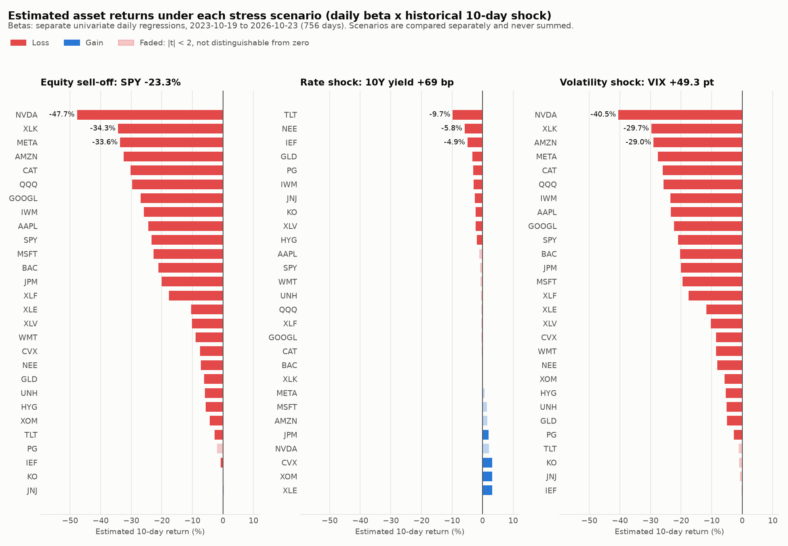

# Portfolio 분석 결과

기준일 2026-10-23 스냅샷, 추정 기간 2023-10-19 ~ 2026-10-23(756거래일).
모든 수치는 `python -m analysis.<스크립트>`로 다시 만들 수 있습니다.

## 팩터 베타 분석

- 스크립트: `analysis/portfolio_factor_betas.py`
- 결과: `asset_factor_betas.csv`(28개 자산 × 베타·R²·t값·표본 수), `asset_scenario_returns.png`
- 방법: 자산 일간 수익률을 팩터 하나씩(SPY 수익률, 10년 금리 변화 bp, VIX 변화 pt) 따로 회귀했습니다. 시나리오 추정 수익률 = 베타 × 시나리오 충격. |t| < 2인 베타는 0과 구분되지 않는 값으로 봅니다.

### 1. 주식 급락(SPY −23.3%)에서는 기술주 손실이 시장의 두 배까지 커집니다

| 손실 큰 자산 | 추정 수익률 | Market 베타 |
|---|---|---|
| NVDA | −47.7% | 2.05 |
| XLK | −34.3% | 1.47 |
| META | −33.6% | 1.44 |
| AMZN | −32.5% | 1.39 |
| CAT | −30.2% | 1.30 |

JNJ와 KO는 Market 베타가 0과 구분되지 않고, IEF −0.8%, TLT −2.8%로 국채의 손실이 가장 작습니다.

### 2. 변동성 충격은 주식 급락과 거의 같은 위험을 다시 보여줍니다

SPY 수익률과 VIX 변화의 상관은 −0.83입니다. 그래서 VIX +49.3pt 충격의 손실 순위(NVDA −40.5%, XLK −29.7%, AMZN −29.0%)가 주식 급락과 거의 같습니다. 주식 포트폴리오에서는 변동성 충격이 별개의 위험이라기보다 주식 위험의 다른 표현이고, 두 시나리오 손실을 더하면 같은 위험을 두 번 세게 됩니다.

### 3. 금리 충격은 시장과 독립적인 위험이고, 방어주가 약합니다

SPY 수익률과 금리 변화의 상관은 −0.06으로, 금리 충격(+69bp)은 다른 두 시나리오가 잡지 못하는 위험을 보여줍니다.

| 구분 | 자산 (추정 수익률, t값) |
|---|---|
| 손실 | TLT −9.7% (t −64), NEE −5.8% (t −7.9), IEF −4.9%, GLD −3.3%, PG −3.0%, IWM −2.9%, JNJ −2.6%, KO −2.3%, XLV −2.3%, HYG −1.9% |
| 이익 | XLE +3.2%, XOM +3.2%, CVX +3.2% (t 4.7~5.0), JPM +2.0% (t 2.8) |
| 0과 구분 안 됨 | NVDA, MSFT, AMZN, META, AAPL, GOOGL 등 빅테크 (\|t\| < 2) |

주식 급락에 강했던 필수소비재·헬스케어·유틸리티·금이 금리 급등에는 손실을 냅니다. 자산 단위로는 빅테크를 이런 자산으로 바꾸면 주식 충격 위험을 금리 충격 위험과 맞바꾸게 됩니다.

다만 이 맞교환이 포트폴리오 단위에서 유의한지는 옮기는 자산과 비중에 달려 있습니다. 빅테크 4종(AAPL·MSFT 30%, NVDA·AMZN 20%)에서 30%를 옮길 때 포트폴리오 금리 베타의 t값은 다음과 같습니다(API의 `stress[].significant`와 같은 기준).

| 변경 후 포트폴리오 | 금리 충격 손실 | 금리 베타 t | 주식 급락 손실 |
|---|---|---|---|
| 변경 전 (빅테크 4종) | −0.84% | 1.21 (유의 아님) | 30.2% |
| TLT·GLD·XLV 10%씩 | 0.94% | −1.83 (유의 아님) | 23.0% |
| TLT·GLD 15%씩 | 1.36% | −2.66 | 22.5% |
| **TLT 30% (시연 예시)** | **2.33%** | **−4.66** | **22.0%** |

그래서 시연 예시는 TLT 30%로 정했습니다. 변경 전에는 0과 구분되지 않던 금리 충격 영향이, 변경 후에는 유의한 손실(2.33%)로 나타납니다. TLT·GLD·XLV 10%씩 나누면 주식 충격 손실은 비슷하게 줄지만 금리 위험은 통계적으로 확인되지 않습니다.

### 4. 베타가 작은 것과 안전한 것은 다릅니다

시장에 민감한 기술·금융·산업 종목도 Market R²가 0.31~0.45로, 일간 움직임의 절반 이상이 시장으로 설명되지 않습니다. XOM(R² 0.015), UNH(0.011), JNJ(0.000)는 Stress 추정 손실이 작지만, 위험이 없어서가 아니라 세 팩터와의 연결이 약해서입니다. 이런 종목 고유 위험은 Stress Test가 아니라 변동성·위험 기여도(Hidden Risk Map)에서 드러납니다.

### 한계

- 팩터 베타 분석은 최근 3년 베타에 2020년 3월·2022년 6월 같은 과거 위기 충격을 적용한 현재 민감도 비교입니다. 실제 위기 손실을 재현하는지는 별도 검증이 필요합니다. [Stress 검증](stress_validation_report.md)에서는 충격 시작 전 베타로 손실을 재현했으며, 변경 전 포트폴리오의 주식·변동성 충격에서는 과대 추정, 금리 충격에서는 과소 추정이 나타났습니다. 손실 오차가 일관되게 보수적이라고 볼 수 없습니다.
- 일간 베타에 10거래일 충격을 곱한 선형 근사이며, 미래 손실 예측이 아닙니다.

## Stress 검증: 추정 대비 실제 손실

[검증 결과·방법·한계](stress_validation_report.md)를 참고하세요. 28개 자산 및 변경 전·후 포트폴리오의 고정 위기 구간과, 756일 학습창을 갖춘 145개 비중첩 10거래일 구간을 비교했습니다. 고정 위기 구간에는 사후 선택과 2020년 학습 이력 부족의 한계가 있습니다. 결과를 실제 총손실 예측 정확도로 해석하지 않습니다.

### 첫 수정: 공동추정 베타와 동시 충격

[별도 실험 결과](joint_stress/experiment.md)에 주식+금리, 주식+금리+VIX 다중회귀를 추가했습니다. 당시 동시 충격을 입력하고 기존 시장 모델·단순 SPY·동일 학습 표본 기준과 비교했습니다. 주식+금리 모델의 평균 오차와 꼬리 구간 과소추정은 두 예시 포트폴리오에서 줄었으나, 코로나 등 일부 고정 사례의 오차는 커졌습니다. 현재 145개 구간에서의 개선 후보이며 새로운 미사용 구간의 검증 전 운영 채택으로 해석하지 않습니다.

### 두 번째 수정: 10거래일 수익률 직접 학습

[직접 학습 실험](direct_10d_stress/stress_validation_report.md)은 구간이 겹치지 않는 10거래일 자산 수익률을 같은 기간의 주식·금리 변화에 회귀합니다. 모든 학습 구간은 평가 시작일 전에 끝나며, 절편 포함·제외 및 일간 절편 누적 비교를 함께 제공합니다. 고정 위기 사례의 오차는 줄었지만 전체 145개 구간의 MAE와 큰 손실 구간 과소추정은 첫 수정보다 악화했습니다. 두 번째 후보는 대체 모델로 채택하지 않고 첫 수정의 일간 주식+금리 모델을 추가 검증 우선 후보로 유지합니다.

### 상황별 오차 분석

[상황별 진단](regime_stress/stress_validation_report.md)은 첫 수정의 고정 결과를 주식 급락(10일 SPY ≤−5%)·금리 급등(≥+20bp)의 네 상호 배타적 상황으로 분류합니다. 동반 충격 2개·나머지 주식 급락 3개는 일반화하기에 작은 표본입니다. 금리 급등 기준만 충족한 23개 구간은 기본 정의에서 과대추정 방향이 전후반 반복됐으나 임계값을 바꾸면 방향이 달라질 수 있었습니다. 두 기준 미충족 117개 구간의 평균 편향도 전후반에 방향이 바뀌었습니다. 진단용 고정 기준이며 상황별 보정이나 모델 전환의 성능 검증으로 해석하지 않습니다.

금리 급등 상황을 실제 손실·이익으로 다시 나누면, 변경 전·후의 실제 손실 구간 평균 `실제−추정`은 각각 +0.36/+0.06%p였습니다. 전체 평균 −0.53/−0.58%p와 방향이 달라, 전체 평균만으로 손실 추정이 보수적이라고 판단하거나 일괄 보정하지 않습니다. 이는 실제 결과에 따른 사후 조건부 진단이며 사전 식별 규칙이 아닙니다.

### 과거 오차 범위와 실제 포함률

[오차 범위 검증](error_band_stress/stress_validation_report.md)은 평가 시작일 전에 결과가 확정된 최근 최대 60개 오차로 범위를 만들고 최소 30개 미만이면 미확인으로 유지합니다. 점 추정값은 바꾸지 않았습니다. 평가 가능한 114개 구간에서 비대칭 범위의 포함률은 변경 전 91.2%, TLT 편입 후 92.1%였지만 평균 폭은 8.89/6.51%p였고 실제 손실 44개 구간만의 포함률은 모두 88.6%였습니다. 대칭 비교 방식의 폭·포함률·구간 점수도 공개합니다. 동일한 이미 관측된 기간에서의 시간순 검증으로, 미래 90% 포함 보장이나 최대 손실 한도가 아닙니다.

### 새 기간 검증 기록

[새 기간 파이프라인](../../docs/PORTFOLIO_FORWARD_VALIDATION_KO.md)은 당시 입력·규칙·베타·오차 분포를 봉인하고 이후 10개 SPY 관측이 확정된 뒤 평가합니다. 반복 실행은 결과를 덮어쓰거나 중복하지 않으며, 과거 연구용 초기 오차와 새 기간 성과를 구분합니다. 실제 수집·평가 대기 상태는 [실행 점검](forward_stress/stress_validation_report.md)에 남깁니다. 예약 설정 파일의 존재와 원격 예약의 실제 활성화는 구분합니다.
