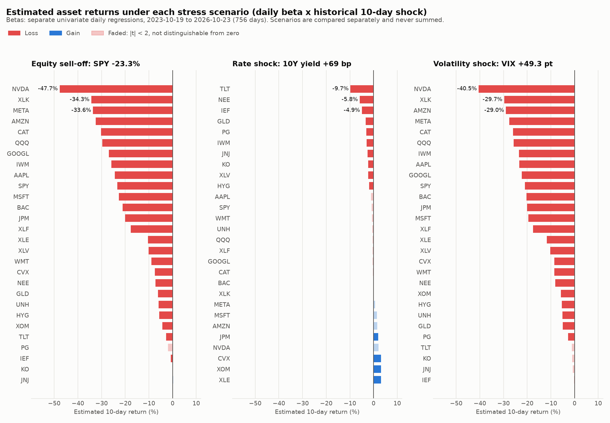

# Portfolio 분석 결과

기준일 2026-10-23 스냅샷, 추정 기간 2023-10-19 ~ 2026-10-23(756거래일).
모든 수치는 `python -m analysis.<스크립트>`로 다시 만들 수 있습니다.

## A1. 자산별 팩터 베타

- 스크립트: `analysis/portfolio_factor_betas.py`
- 결과: `asset_factor_betas.csv`(28개 자산 × 베타·R²·t값·표본 수), `asset_scenario_returns.png`
- 방법: 자산 일간 수익률을 팩터 하나씩(SPY 수익률, 10년 금리 변화 bp, VIX 변화 pt) 따로 회귀했습니다. 시나리오 추정 수익률 = 베타 × 시나리오 충격. |t| < 2인 베타는 0과 구분되지 않는 값으로 봅니다.

### 1. 주식 급락(SPY −23.3%)에서는 기술주 손실이 시장의 두 배까지 커집니다

| 손실 큰 자산 | 추정 수익률 | Market 베타 |
|---|---|---|
| NVDA | −47.7% | 2.05 |
| XLK | −34.3% | 1.47 |
| META | −33.6% | 1.44 |
| AMZN | −32.5% | 1.39 |
| CAT | −30.2% | 1.30 |

JNJ와 KO는 Market 베타가 0과 구분되지 않고, IEF −0.8%, TLT −2.8%로 국채의 손실이 가장 작습니다.

### 2. 변동성 충격은 주식 급락과 거의 같은 위험을 다시 보여줍니다

SPY 수익률과 VIX 변화의 상관은 −0.83입니다. 그래서 VIX +49.3pt 충격의 손실 순위(NVDA −40.5%, XLK −29.7%, AMZN −29.0%)가 주식 급락과 거의 같습니다. 주식 포트폴리오에서는 변동성 충격이 별개의 위험이라기보다 주식 위험의 다른 표현이고, 두 시나리오 손실을 더하면 같은 위험을 두 번 세게 됩니다.

### 3. 금리 충격은 시장과 독립적인 위험이고, 방어주가 약합니다

SPY 수익률과 금리 변화의 상관은 −0.06으로, 금리 충격(+69bp)은 다른 두 시나리오가 잡지 못하는 위험을 보여줍니다.

| 구분 | 자산 (추정 수익률, t값) |
|---|---|
| 손실 | TLT −9.7% (t −64), NEE −5.8% (t −7.9), IEF −4.9%, GLD −3.3%, PG −3.0%, IWM −2.9%, JNJ −2.6%, KO −2.3%, XLV −2.3%, HYG −1.9% |
| 이익 | XLE +3.2%, XOM +3.2%, CVX +3.2% (t 4.7~5.0), JPM +2.0% (t 2.8) |
| 0과 구분 안 됨 | NVDA, MSFT, AMZN, META, AAPL, GOOGL 등 빅테크 (\|t\| < 2) |

주식 급락에 강했던 필수소비재·헬스케어·유틸리티·금이 금리 급등에는 손실을 냅니다. 빅테크 비중을 이런 자산으로 옮기는 What-if는 주식·변동성 충격 손실을 줄이는 대신 금리 충격 손실을 키우는 맞교환이 됩니다.

### 4. 베타가 작은 것과 안전한 것은 다릅니다

시장에 민감한 기술·금융·산업 종목도 Market R²가 0.31~0.45로, 일간 움직임의 절반 이상이 시장으로 설명되지 않습니다. XOM(R² 0.015), UNH(0.011), JNJ(0.000)는 Stress 추정 손실이 작지만, 위험이 없어서가 아니라 세 팩터와의 연결이 약해서입니다. 이런 종목 고유 위험은 Stress Test가 아니라 변동성·위험 기여도(Hidden Risk Map)에서 드러납니다.

### 한계

- 베타는 큰 위기가 없던 최근 3년으로 추정했지만, 충격은 2020년 3월·2022년 6월 같은 위기 구간 값입니다. 위기 때는 자산 간 상관이 높아지는 경향이 있어 손실을 작게 추정했을 수 있습니다. A5(추정 대비 실제 손실 검증)에서 확인합니다.
- 일간 베타에 10거래일 충격을 곱한 선형 근사이며, 미래 손실 예측이 아닙니다.
